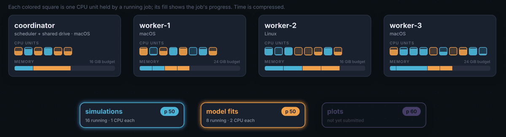
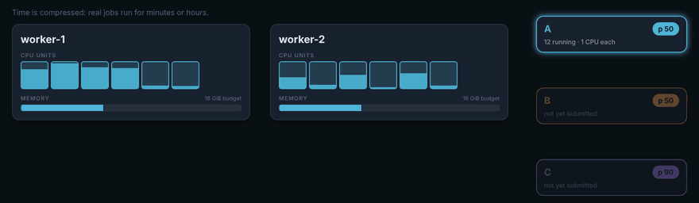
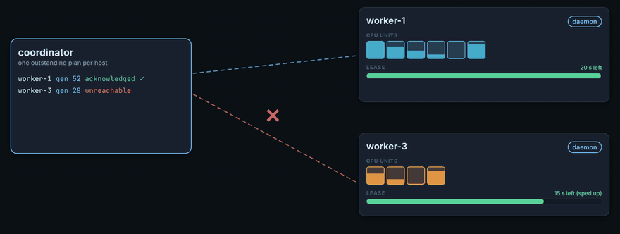
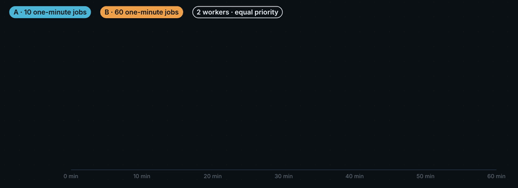

# ROTA

A lightweight SSH job scheduler for small, trusted macOS/Linux clusters. A rota is a
schedule of turns; here it is also the **R**esource- and **O**wner-aware **T**ask **A**llocator.



Run independent shell jobs with fixed workers, node-local shards, or an adaptive
pool that shares CPU and memory budgets between queues. Jobs keep running when
admission is paused; dependencies, failure holds, and audited recovery are explicit.

The scheduler uses Bash, Python's standard library, and filesystem records rather
than a database. The tmux dashboard supports macOS and Linux CPU/memory sampling,
queue progress, shared storage, and network/block-device activity.

The [illustrated operations guide](docs/operations.md#submit-your-own-queue)
traces one job through the scheduler and explains recovery after a worker loses
contact. Its [ETA walkthrough](docs/operations.md#completion-estimates) shows
how a queue can finish sooner when another queue releases its workers. See
[how it compares](docs/comparison.md) with Slurm, Kubernetes, HTCondor and GNU Parallel.

| Priorities | Leases | Forecasts |
| --- | --- | --- |
|  |  |  |
| Equal priorities share; a higher one takes each freed slot. No job is stopped. | An unreachable host starts nothing new once its lease runs out; its jobs keep running. | The pool ETA replays the scheduler, so B speeds up when A finishes. |

## Set up another cluster

1. On the storage host (the coordinator), clone this repository with Git and open a Bash
   shell in the checkout. Deployment records the Git commit and needs a clean
   working tree. GitHub’s source ZIP omits this metadata. Configure passwordless
   SSH from the coordinator to every configured target, including itself. The
   writable drive must have the same absolute path on every host. Install Bash,
   Python 3.9+, SSH and Perl/shasum. The dashboard
   also needs tmux. Host-local shards use GNU Parallel.
2. Copy the [example inventory](examples/cluster.json) to `cluster.local.json`
   and edit that one file. Set the shared mount path, coordinator ID, each
   host’s SSH target and its CPU and memory allowances. The scheduler, deployment
   tools and dashboard use settings generated from the inventory. Job commands,
   inputs and outputs belong to individual project queues. Keep SSH keys in
   your SSH configuration. Optional settings turn on backfill, GPU units, and
   holding or suspending work while a machine's owner is at the keyboard
   ([opt-in features](docs/operations.md#opt-in-host-and-queue-features)).
3. From the coordinator, run `./doctor cluster.local.json`. It checks each SSH
   route, runtime tools, writable storage and a marker shared with the coordinator.
   Then generate the configuration and activate it in this shell:

   ```bash
   env_file=$(python3 cluster_config.py cluster.local.json --render)
   source "$env_file"
   ```

   The generated file lives under the configured shared root. Source that same
   file in any new admin, coordinator or dashboard shell. If administering from
   another machine, `ssh "$ROTA_COORDINATOR"` opens the coordinator
   shell. Source the file there too.
4. From the coordinator checkout, deploy to an idle cluster and start its pool:

   ```bash
   ./deploy.sh --scheduler-only
   ./sync_rota_monitoring.sh
   "$ROTA_ROOT/adaptive_scheduler.sh" pool-start
   ```

5. **[Run your first two jobs and verify their results](examples/first-job/README.md).**
   The example includes the worker script and needs only Python. The
   [operations guide](docs/operations.md) covers your own workloads.

### The `rota` command

`rota <command>` is the front door. From a checkout it runs `control` (the JSON
pool controls Agent Bar uses), `config`, `doctor`, `monitor` and `deploy`. Every
other command goes to the scheduler on the shared root: `rota submit`,
`rota pool-status`, `rota pause`, `rota start`, `rota kill`, `rota reconcile`
and the rest of `rota help-scheduler`. The collector installer below links it
into `~/.local/bin`; elsewhere, `ln -s "$PWD/rota" ~/.local/bin/rota`.

### Open the dashboard

On the dashboard host, source the generated environment and run
`./start_monitoring.sh --direct` from its checkout to sample the hosts over SSH.
For the shared snapshot used by the CLI and Agent Bar on Linux, run
`./admin/install_cluster_status_collector.sh` from that configured shell, then
`./start_monitoring.sh`. The installer keeps a local copy of the inventory
settings for the service and `rota control`. Rerun the installer after selecting
a different inventory. [Monitor and recover](docs/operations.md#monitor-and-recover)

## Supported workloads

The scheduler runs independent shell jobs across trusted macOS and Linux
machines. Each eligible host needs the workload’s dependencies. An unreachable
worker may still be running its job. Confirm its state before rerunning it.
See the [operations guide](docs/operations.md) for placement, monitoring and recovery.

## Tests

GitHub Actions runs inventory, shell compatibility and ETA tests on Linux and
macOS. Linux also runs native monitoring and the first-job lifecycle fixture.
Run the portable suite with `python3 -m unittest discover -s tests` in a quiet
Linux test environment with tmux installed. The fresh-cluster test starts local scheduler processes and
uses a fixture in place of SSH.

## License

ROTA is licensed under the GNU General Public License, version 2
or any later version (SPDX `GPL-2.0-or-later`). See [LICENSE](LICENSE).
