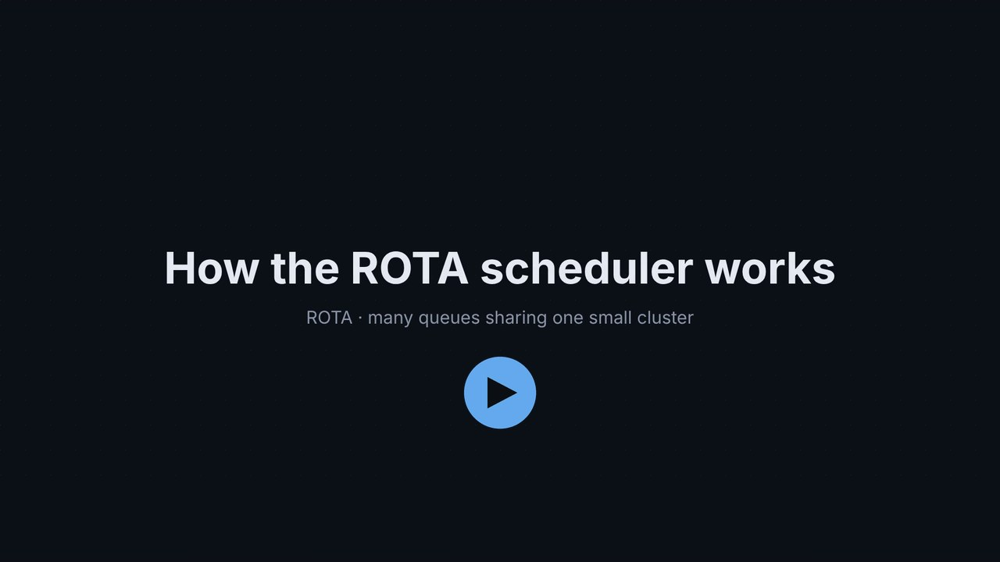
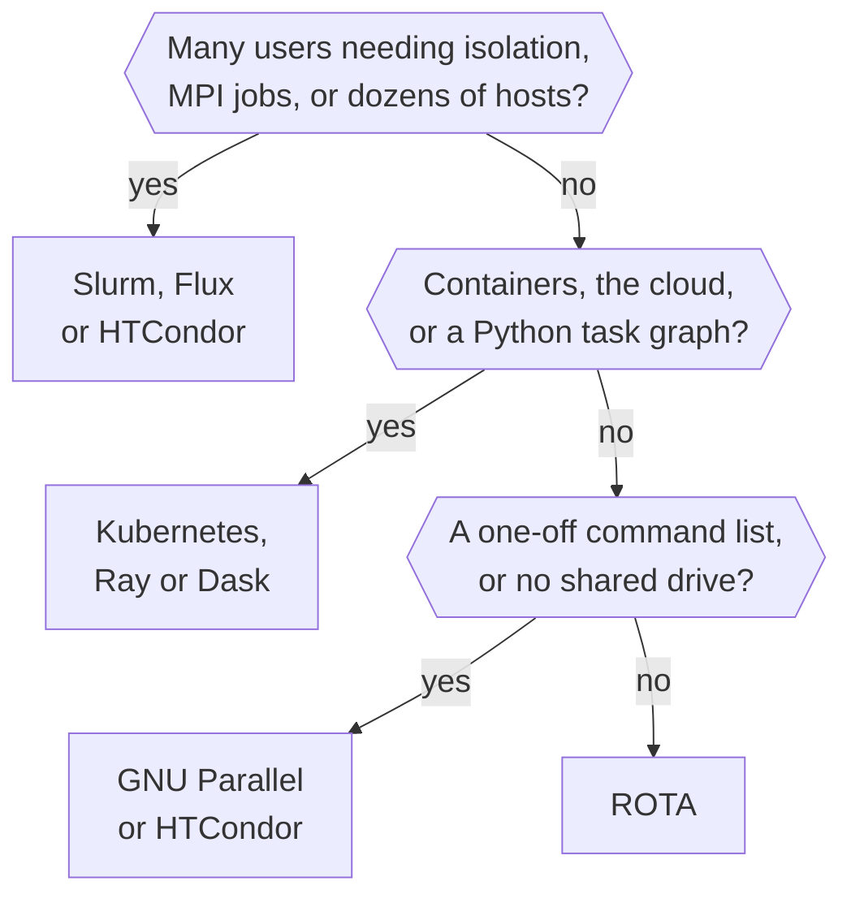

# ROTA

ROTA is a job scheduler that runs independent tasks on Mac and Linux machines that share a drive.
It divides the machines' CPU, memory and shared-drive I/O among queues by priority, and it
needs no root access, database or containers.


Suppose you have two analyses to run and want the results of one before the other.
Give that queue the higher priority. As jobs finish, the adaptive pool gives it
first choice of the CPU and memory that free up. The change in priority leaves running jobs alone.
Give the queues equal priority if you want both to make progress together.
You can pause new starts, hold a stage until its predecessors succeed, and audit
failed work before retrying it. If you prefer a fixed allocation, assign workers
per host or divide the queue into host-local shards.

The coordinator reaches each host over SSH. In an adaptive pool, a daemon on
each host starts its workers locally. ROTA keeps its records on the shared drive.
It uses Bash and Python’s standard library. The tmux dashboard shows queue progress,
CPU and memory use on each host, and traffic on the network and storage devices.

The [operations guide](docs/operations.md#submit-your-own-queue) follows a job from
submission to completion, including what to check if its worker loses contact. The [ETA walkthrough](docs/operations.md#completion-estimates)
shows what happens to the second queue’s forecast when the first finishes.
For clusters with different requirements, see the [scheduler comparison](docs/comparison.md).

| Priorities | Leases | Forecasts |
| --- | --- | --- |
|  |  |  |
| Queues at equal priority share slots. A higher priority takes the next eligible slot. | When a host’s lease expires, its running jobs continue. New starts wait for contact to resume. | A finishes at minute 10. B then gets both workers and finishes at minute 35. |

<a href="https://youtu.be/NRnLCDgYsQw"></a>

**[Watch: how the ROTA scheduler works](https://youtu.be/NRnLCDgYsQw)** (17 min). Chapters cover the cluster, the pool, submitting a queue, budgets, deciding who runs, leases, claiming jobs, failures and recovery, operator controls, dependencies, forecasts and the opt-in extensions.

## When to use ROTA



[How it compares](docs/comparison.md) explains each branch in more detail.

## Set up another cluster

1. Clone this repository with Git on the machine with the shared drive attached
   (the coordinator). Open a Bash shell in the checkout. Deployment records the
   commit and requires a clean working tree, so a GitHub source ZIP won’t work.
   Set up passwordless SSH from the coordinator to every target, including itself.
   Mount the drive read-write at the same absolute path on every host. Install
   Bash, Python 3.9+, SSH, Perl and shasum. The dashboard also uses tmux, and
   host-local shards use GNU Parallel.
2. Copy the [example inventory](examples/cluster.json) to `cluster.local.json`.
   Enter the shared mount path and coordinator ID, then give each host an SSH
   target and CPU and memory allowances. The scheduler, deployment
   tools and dashboard use settings generated from the inventory. Job commands,
   inputs and outputs belong to individual project queues. Keep SSH keys in
   your SSH configuration. Optional settings turn on backfill, GPU units, and
   holding or suspending work while a machine's owner is at the keyboard
   ([opt-in features](docs/operations.md#opt-in-host-and-queue-features)).
3. From the coordinator, run `./doctor cluster.local.json`. It checks the SSH
   routes and tools, tests write access, and verifies that each host can read a
   marker the coordinator wrote. Once it passes, load the configuration in this shell.

   ```bash
   env_file=$(python3 cluster_config.py cluster.local.json --render)
   source "$env_file"
   ```

   The generated file lives under the configured shared root. Source that same
   file in any new admin, coordinator or dashboard shell. If administering from
   another machine, `ssh "$ROTA_COORDINATOR"` opens the coordinator
   shell. Source the file there too.
4. From the coordinator checkout, deploy to an idle cluster and start its pool:

   ```bash
   ./deploy.sh --scheduler-only
   ./sync_rota_monitoring.sh
   "$ROTA_ROOT/adaptive_scheduler.sh" pool-start
   ```

5. **[Run your first two jobs and verify their results](examples/first-job/README.md).**
   The example includes the worker script and needs only Python. The
   [operations guide](docs/operations.md) covers your own workloads.

### The `rota` command

Use `rota <command>` from a checkout for `config`, `doctor`, `monitor`, `deploy`
and `control` (the JSON interface Agent Bar uses). For `rota submit`,
`rota pool-status`, `rota pause`, `rota start`, `rota kill` and `rota reconcile`,
the command calls the scheduler on the shared drive. Use `rota help-scheduler`
for the full list. The collector installer links `rota`
into `~/.local/bin`. On other machines, use `ln -s "$PWD/rota" ~/.local/bin/rota`.

### Open the dashboard

On the dashboard host, source the generated environment and run
`./start_monitoring.sh --direct` from its checkout to sample the hosts over SSH.
For the shared snapshot used by the CLI and Agent Bar on Linux, run
`./admin/install_cluster_status_collector.sh` from that configured shell, then
`./start_monitoring.sh`. The installer keeps a local copy of the inventory
settings for the service and `rota control`. Rerun the installer after selecting
a different inventory. [Monitor and recover](docs/operations.md#monitor-and-recover)

## Supported workloads

Each job runs on one host. If both Macs and Linux machines can claim a job,
its command, binaries and dependencies must work on both. If a worker drops
off the network, it may still finish the job. Confirm the job’s state and check its outputs before
running it again.
See the [operations guide](docs/operations.md) for placement, monitoring and recovery.

## Tests

GitHub Actions runs inventory, shell compatibility and ETA tests on Linux and
macOS. On Linux, CI also checks native monitoring and runs the first-job example through completion.
Run the portable suite with `python3 -m unittest discover -s tests` in a quiet
Linux test environment with tmux installed. The fresh-cluster test starts local scheduler processes and
uses a fixture in place of SSH.

## License

ROTA is licensed under the GNU General Public License, version 2
or any later version (SPDX `GPL-2.0-or-later`). See [LICENSE](LICENSE).
