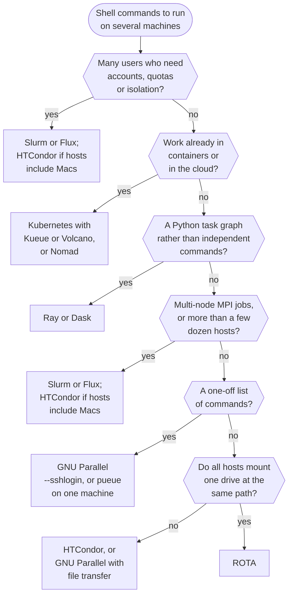

# How ROTA compares with other schedulers

ROTA is a job scheduler for a handful of trusted macOS and Linux machines that share
one drive. This page compares it with Slurm, Kubernetes, GNU Parallel and other systems, and says
when each fits better. External facts come from each project's documentation as of November 2026;
see [Sources](#sources).

## Where it fits

| Category | Systems | Typical user |
| --- | --- | --- |
| Institutional HPC batch | Slurm, PBS Pro/OpenPBS, Flux | A site with administrators, accounts and a Linux cluster |
| High-throughput and opportunistic computing | HTCondor | Pools of lab desktops or campus grids |
| Container orchestration with batch queueing | Kubernetes Jobs with Kueue or Volcano; Nomad | Platform teams running containerized work |
| In-process distributed frameworks | Ray, Dask | Python programs that build task graphs |
| Ad-hoc multi-host fan-out | GNU Parallel `--sshlogin` | One user running one command list over SSH |
| Single-machine queues | task-spooler, pueue | One user on one machine |
| **Small shared-drive pool** | **ROTA** | One person or a small trusted group with a few personal or lab machines |

ROTA sits between GNU Parallel and HTCondor or Slurm. Like GNU Parallel, it needs only
SSH and standard tools: no root, no system services, no database and no containers. Unlike GNU
Parallel, it keeps a persistent pool. Many queues share each host's CPU, memory and shared-drive
I/O budgets by priority, and their priorities and limits can change while jobs run.

Workflow managers such as Snakemake and Nextflow sit above schedulers rather than replacing them.
Celery is a task queue for Python functions, not a scheduler for shell commands.

### Terms

| ROTA | Meaning | Nearest term elsewhere |
| --- | --- | --- |
| pool | The hosts and one coordinator, started together | HTCondor pool; a Slurm cluster |
| coordinator | One process that plans how many jobs each host runs | Slurm controller (`slurmctld`), HTCondor central manager |
| host daemon | One process per host that measures its load and starts jobs | Slurm `slurmd`, HTCondor `condor_startd`, Kubernetes kubelet |
| queue | One submitted list of shell commands, with its own priority, limits and pause state | Slurm job array, HTCondor cluster. Not a Slurm partition or PBS queue, which are groups of nodes |
| worker | The process that claims one job and runs it | HTCondor `condor_starter` |
| reservation | The CPU, memory and devices charged to one running job | Kubernetes resource request, HTCondor dynamic slot |
| lease | How long a host keeps acting on its last plan without hearing from the coordinator | Kubernetes node lease |

## What ROTA has that the others mostly lack

- **No installation beyond SSH.**
  - It is Bash, Python's standard library and plain files on a shared drive
    ([README](../README.md)). Its host daemons are ordinary user processes started over SSH. Nothing needs
    root.
  - GNU Parallel is the only other system here with a comparable footprint.
  - Slurm needs a root daemon on every node, a controller and optionally MySQL. Kubernetes needs a
    control plane, etcd and containers. HTCondor and PBS run several daemons, and PBS also needs
    PostgreSQL.
- **macOS as a full execution host.**
  - Job memory on macOS counts the larger of resident size and physical footprint. Unrelated apps
    count the smaller.
  - Revoked SMB file handles are detected, and the file server's load is guarded.
  - Slurm, Kubernetes, Flux and multi-node Ray do not support macOS execution hosts.
  - HTCondor's Darwin port has documented caveats. Nomad runs on macOS only with the unisolated
    `raw_exec` driver.
- **Borrowed and personal machines.**
  - Each host can have its own priority or be `off` for a queue, so a friend's machine runs your
    queue only when its owner's queues leave room.
  - `set-host-state away` frees a host now or in a scheduled window, without stopping running jobs.
  - Unrelated load on a host lowers its capacity automatically.
  - HTCondor's desktop policy goes further and suspends jobs on keyboard activity. The large
    schedulers have nothing comparable.
- **Charging for observed memory, not just declarations.** A job is charged the larger of its
  declared memory and recent observed use, held for five minutes after a spike. Ray, Dask and GNU
  Parallel trust declarations or gate only at start. Slurm and Kubernetes enforce the declared limit
  instead.
- **Completion forecasts that replay the scheduler.**
  - The pool ETA simulates the real allocator each time a job is expected to finish, so it predicts
    that a queue speeds up when another finishes ([operations guide](operations.md#completion-estimates)).
  - Slurm (`squeue --start`) and PBS (`qstat -T`) estimate only when pending jobs will *start*.
    GNU Parallel's `--eta` covers one run.
- **Leases that never kill work.**
  - A host that stops hearing from the coordinator starts nothing new once its 20-second lease
    expires, and its running jobs continue and stay charged.
  - An unreachable host is never presumed lost, and success is never inferred: an uncertain job
    stays charged until it is audited.
- **Admission for shared-drive I/O.** Queues declare I/O units against a pool-wide token count.
  When the file server is overloaded, only queues that hold I/O units pause.
- **Auditable state in plain files.**
  - Queues are read-only copies. A claim is an atomic directory, and success is a done marker.
  - Controls, resets and recoveries are recorded with reasons.
  - Deploys require a clean Git tree, and each pool runs hash-pinned copies of the scheduler.

## What the others have that ROTA lacks

The last column says whether ROTA now covers the gap as an opt-in setting
([operations guide](operations.md#opt-in-host-and-queue-features)), or whether it could
without giving up its design goals: no root, no services, macOS support.

| Feature | Who has it | In ROTA |
| --- | --- | --- |
| **Enforced resource limits** (cgroups) | Slurm, HTCondor and PBS on Linux; Kubernetes; Nomad on Linux | **Partly, opt-in.** `--memory_limit_mib` ends a job whose process tree exceeds the limit at a resource sample, on macOS and Linux. It is not a kernel limit: a fast spike can pass between samples. Linux cgroups (`systemd-run --user --scope -p MemoryMax=…`) would be a possible hardening where user delegation is enabled. |
| **Preemption, suspend or requeue** | Slurm, HTCondor, Kueue, Volcano, Nomad | **Owner-triggered only, opt-in.** `owner_active: "suspend"` stops a host's running jobs while its owner is at the keyboard and resumes them afterwards. Preemption by priority, stopping or requeuing lower-priority work, stays absent by design: jobs are claimed exactly once and need not be safe to rerun. |
| **Backfill** with walltime-based reservations | Slurm, PBS | **Yes, opt-in** (`backfill: true`). A host held for a large job may run shorter jobs whose measured 90th-percentile runtime ends before the large job could fit. Estimates come from each queue's completed jobs, so there is no walltime to declare. |
| **Fair share** across users, with accounting | Slurm (slurmdbd), HTCondor, flux-accounting | **Possible, low value.** The scheduler assumes trusted users. Per-owner usage could be summed from queue registrations and done markers. |
| **Multi-user authentication and isolation** | Slurm (MUNGE), HTCondor tokens, Kubernetes RBAC, Flux | **No, by design.** It is a trusted-user tool ([support boundaries](../README.md#supported-workloads)). Real isolation needs privileged components. |
| **GPU and other device scheduling** | Slurm GRES, Kubernetes device plugins, HTCondor, Nomad | **Yes, opt-in** (host `gpu_units`, `--gpu_units_per_job`). Device units are a fourth resource; each job gets its own indices through `CUDA_VISIBLE_DEVICES`. GPU use by other programs is not measured, and a Mac's GPU cannot be divided. |
| **Multi-node (gang, MPI) jobs** | Slurm, Volcano, Kueue, Flux | **Hard.** Each job runs on one host. Co-reserving slots on several hosts would change the allocator and the lease model. |
| **Highly available controller** | Slurm (backup controller), Kubernetes (etcd), Nomad (Raft), PBS | **Partly.** Running jobs survive a coordinator crash, and recovery is a manual `--recover-inactive`. A user-level supervisor (launchd or systemd `--user`) could restart it. Automatic failover would need another host to take over the drive. |
| **No shared drive required**: files are staged in and out | HTCondor, GNU Parallel `--transferfile`, Kubernetes volumes | **Partly.** The design depends on one shared drive. Per-queue stage-in and stage-out hooks are possible; claims and markers would still need it. |
| **Checkpoint support** | HTCondor self-checkpointing | **Low priority.** Nothing is preempted, so checkpoints matter only to the application itself. |
| **Scale** to thousands of nodes | Slurm, PBS, HTCondor, Kubernetes | **No.** It is tested on six hosts with about 50 cores, and the coordinator polls with at most 8 SSH threads. Dozens of hosts are probably workable but unverified. |
| **Workflow-manager integration** | Executors for Slurm, HTCondor, Kubernetes, Flux in Snakemake; Nextflow | **Yes.** Snakemake's generic cluster executor could call `submit` and poll status; the workflow manager would add a dependency graph. Queues already support `--after` and `submit-chain`. |
| **Idle detection on desktops** (suspend on keyboard use) | HTCondor | **Yes, opt-in** (host `owner_idle_seconds`). No new starts while the console is in use (macOS idle time, Linux logind idle hint), optionally suspending running jobs. HTCondor's policies go further, for example vacating jobs or reacting to CPU load as well as the keyboard. |

## Comparison at a glance

| | ROTA | Slurm | Kubernetes + Kueue | HTCondor | GNU Parallel | Ray / Dask |
| --- | --- | --- | --- | --- | --- | --- |
| Install | SSH, Bash, Python | root daemons, controller, optional DB | control plane, etcd, containers | several daemons | Perl, SSH | Python packages |
| macOS execution hosts | yes | no | no | Darwin port | yes | single-node Ray; Dask runs, no stated support |
| Persistent queue with priorities | yes | yes | yes | yes | no | no queue / graph order |
| Shares budgets across concurrent queues | yes | yes | yes | yes | no | n/a |
| Resource enforcement | accounted, observed memory; opt-in sampled memory limit | cgroups | cgroups | cgroups on Linux | none | none (Dask nanny caps memory) |
| Preemption | never by priority; opt-in suspend while the owner is active | yes | yes | yes | no | no |
| GPUs | opt-in device units | GRES | device plugins | yes | no | logical resources |
| Backfill | opt-in, from measured runtimes | yes, from walltimes | no | no | no | no |
| Node loss | lease expires; jobs keep running and stay charged | requeue | pod replaced | reschedule | `--retries` elsewhere | retry / recompute |
| Dependencies | `--after`, `submit-chain` | `--dependency`, arrays | none (needs Argo etc.) | DAGMan | input order | task graph |
| Shared filesystem | required | customary | no | no | no | depends |
| Multi-user security | trusted users only | accounts, MUNGE | RBAC | tokens, Kerberos | SSH user | weak or token |
| Completion forecast | queue and pool ETA | start times only | no | no | `--eta` for one run | progress bars |
| Scale | a few to dozens of hosts | 10k+ nodes | 5k nodes | 100k+ cores | dozens of hosts | laptop to large |

## Choosing

**Choose ROTA when:**
- you have a few personal or lab machines, including Macs, and one drive they all mount;
- one person or a trusted group runs shell commands that take minutes to hours;
- you want to change priorities, pause queues and lend machines without administrator help or
  restarting work, including machines whose owners are sometimes at the keyboard;
- you want a forecast of when each queue will finish.

**Choose something else when:**
- **Many users need accounts, fair share or isolation,** or MPI, containers or a large GPU fleet
  are central: use Slurm, or Flux on HPC-style Linux clusters.
- **Desktop owners need stronger guarantees than pausing and suspending,** such as vacating jobs,
  or there is no shared drive, and you can run HTCondor's daemons: HTCondor.
- **The work is already containerized, or runs in the cloud:** Kubernetes with Kueue or Volcano, or
  Nomad.
- **The work is a Python task graph rather than shell commands:** Ray or Dask.
- **It is a one-off command list, or there is no shared drive:** GNU Parallel `--sshlogin`, or
  pueue on a single machine.
- **Jobs last only seconds:** each job also pays a few seconds of dispatch overhead. Batch them into
  longer jobs, or use host-local shards ([execution modes](operations.md#execution-modes)).

## Sources

ROTA: [README](../README.md), [operations guide](operations.md).

- Slurm:
  - [administrator quick start](https://slurm.schedmd.com/quickstart_admin.html)
  - [platforms](https://slurm.schedmd.com/platforms.html)
  - [cgroups](https://slurm.schedmd.com/cgroups.html)
  - [multifactor priority](https://slurm.schedmd.com/priority_multifactor.html)
  - [preemption](https://slurm.schedmd.com/preempt.html)
  - [sbatch](https://slurm.schedmd.com/sbatch.html)
  - [squeue](https://slurm.schedmd.com/squeue.html)
- Kubernetes:
  - [large clusters](https://kubernetes.io/docs/setup/best-practices/cluster-large/)
  - [Windows and Linux nodes](https://kubernetes.io/docs/concepts/windows/intro/)
  - [Jobs](https://kubernetes.io/docs/concepts/workloads/controllers/job/)
  - [Kueue](https://kueue.sigs.k8s.io/docs/overview/)
  - [Volcano](https://volcano.sh/en/docs/)
- GNU Parallel: [manual](https://manpages.debian.org/testing/parallel/parallel.1.en.html).
- HTCondor:
  - [features](https://htcondor.readthedocs.io/en/latest/overview/exceptional-features.html)
  - [execution point policy](https://htcondor.readthedocs.io/en/latest/admin-manual/ep-policy-configuration.html)
  - [macOS install](https://htcondor.readthedocs.io/en/latest/getting-htcondor/install-macos-as-root.html)
  - [file transfer](https://htcondor.readthedocs.io/en/latest/users-manual/file-transfer.html)
  - [self-checkpointing](https://htcondor.readthedocs.io/en/latest/users-manual/self-checkpointing-applications.html)
- Nomad:
  - [architecture](https://developer.hashicorp.com/nomad/docs/concepts/architecture)
  - [preemption](https://developer.hashicorp.com/nomad/docs/concepts/scheduling/preemption)
  - [raw_exec](https://developer.hashicorp.com/nomad/docs/drivers/raw_exec)
- Ray:
  - [installation](https://docs.ray.io/en/latest/ray-overview/installation.html)
  - [resources](https://docs.ray.io/en/latest/ray-core/scheduling/resources.html)
  - [job submission](https://docs.ray.io/en/latest/cluster/running-applications/job-submission/index.html)
- Dask:
  - [resources](https://distributed.dask.org/en/stable/resources.html)
  - [worker memory](https://distributed.dask.org/en/stable/worker-memory.html)
- PBS: [OpenPBS](https://github.com/openpbs/openpbs), [qstat](https://github.com/PBSPro/pbspro/blob/master/doc/man1/qstat.1B).
- task-spooler: [task-spooler](https://viric.name/soft/ts/).
- pueue: [pueue](https://github.com/Nukesor/pueue).
- Flux: [Flux](https://flux-framework.readthedocs.io/en/latest/), [flux-core 0.77 notes](http://flux-framework.org/release/2025/08/05/flux-core-0.77.0.html).
- Snakemake: [Snakemake executors](https://snakemake.github.io/snakemake-plugin-catalog/).
- Nextflow: [Nextflow executors](https://docs.seqera.io/nextflow/executor).
