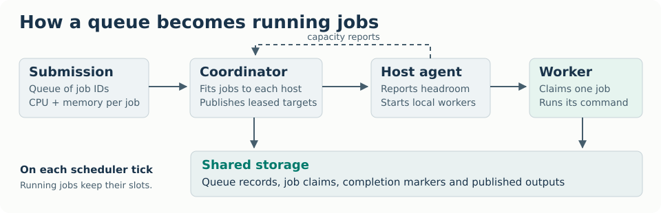

# Operating a small cluster

## Inventory

Copy `examples/cluster.json` to `cluster.local.json`. Set `coordinator` to
the ID of the machine with the drive attached. Mount that drive at the same
absolute path (`shared_root`) on every machine before rendering the inventory.
The coordinator needs SSH access to every target, including itself. You can
disable its worker and still use it to coordinate the pool.

Each host has an ID, an SSH target, a positive CPU allowance, a positive memory
allowance in MiB, and an enabled flag. An SSH target can be an alias from
`~/.ssh/config`. Check the inventory without contacting any machines:

```bash
python3 cluster_config.py cluster.local.json
```

Run `./doctor cluster.local.json` on the coordinator before deployment, or if
a worker loses access. Two machines can each have a writable directory with
the right name and still be looking at different disks. To check, the doctor
writes a random marker on the coordinator and reads it on each host. It also
tests a small write on each host, cleans up the probes and coordinator marker,
and checks noninteractive SSH access and verifies the required tools (Python 3.9+,
Bash, SSH, Perl and shasum).

Use `--project /absolute/shared/project` to check project permissions,
`--shards` to check for GNU Parallel, or `--json` for individual results.
A failed check on the coordinator or an enabled worker gives exit status 1.
Disabled workers have a separate report. If you run the doctor on another
admin host, you are testing SSH routes from that machine.

Rendering writes a versioned environment, a hosts file and a resource table
under the shared root. Source the environment in each admin shell. After an
inventory change, render again and source the new path. A running adaptive
pool retains its current budgets. Drain it before adopting an edited inventory,
or use the scheduler’s live budget controls.

For a second SSH route, add `fallback` to the host and run
`admin/install_ssh_routes.sh "$ROTA_CONFIG_DIR"` on each machine
that initiates those connections. The primary and fallback must reach the same
SSH server. A fallback route carries control traffic. Jobs that need shared
storage still require a working mount.

The example sets `shared_io_capacity` to zero. For the optional SMB admission
guard, set a positive capacity and name the sampling host in `io_pressure_host`.
A job’s default reservation follows the pool setting. Specify `network_interface`
or `disk` when automatic coordinator device selection is unsuitable.

## Submit your own queue



Use the [first-job walkthrough](../examples/first-job/README.md) as a template.
Create `queues/jobs.txt` in a project directory on the shared drive. Each line
contains a unique ID and a shell command. The worker appends
`--job_tag VALUE` to that command. Set separate output paths per job and check
that every eligible host can run the program. Keep the project and queue paths
free of spaces and shell metacharacters.

Run these commands on the coordinator, with the generated environment sourced
and `project` set to your project directory:

```bash
scheduler="$ROTA_ROOT/adaptive_scheduler.sh"
"$scheduler" pool-status
"$scheduler" submit --model_dir "$project" --queue jobs.txt \
  --project my-analysis --run_name pilot \
  --cpu_units_per_job 1 --memory_mib_per_job 512 --max_workers 1
```

Use CPU and memory values measured for your job, including child processes.
Copy the printed `batch_dir` into a shell variable called `batch`.
`"$scheduler" queue-status --batch_dir "$batch"` shows the queue lifecycle.
Inspect `$batch/done/` and the application’s outputs before increasing concurrency.
`--after "$batch"` on a later submission makes it wait for successful completion.

For long-running queues, check the dashboard’s Priority column and choose an
unused `--schedule_priority` (default 50). Give the higher number to the queue
whose results you want first. It gets first choice of eligible slots as jobs
finish. Use the same number when you want the queues to share workers.

## Monitor and recover

The direct dashboard samples the hosts over SSH. On a Linux dashboard host, the
optional systemd user service instead collects shared snapshots for the CLI and
Agent Bar. Install it from the checkout with the rendered environment sourced.
Check it with `systemctl --user status rota-collector` or
`journalctl --user -u rota-collector`. Rerun the installer after
changing inventories.

### Completion estimates

If two queues share a pool, counting the workers each has now can give a poor
estimate of when either will finish. The adaptive ETA measures successful jobs
from claim to completion and asks the scheduler’s allocator where it would put
the next job each time a slot opens. A running job stays on its host. New jobs
must still fit the available CPU, RAM and shared I/O, and respect queue and host
priorities, worker caps, host holds and dependencies.


In this example, B has 50 one-minute jobs left when A finishes. Two workers
finish those jobs in 25 minutes. [Play or step through the timeline](pool-eta.html)
from a local checkout.

The forecast assumes no new submissions and gives pending jobs the mean runtime
of up to 128 successes in their queue. A host with at least three sampled
completions uses its own mean. A running job gets credit for time already spent.
For a queue of very short jobs, launching the next job can take as long as
running it. The monitor includes that gap once it has observed at least five
consecutive same-host refills for the queue.

For an early estimate, add `--early_eta_sample` to an adaptive submission
with at least 20 jobs. Its first two ordinary jobs can take an eligible free
slot ahead of their queue's priority, one at a time. The pool allows one such
slot across all opted-in queues. Dependencies, pauses, host restrictions and
resource limits still apply. Jobs started at normal priority count toward
the two, and the first successful completion can supply an ETA.

A `?` beside a dashboard ETA or a timing note in Agent Bar flags a change in
the job mix or a running job that has outlasted the sample. The estimate still
assumes average remaining jobs. The JSON report includes the mean runtime,
sample count, measured dispatch gaps and warning.
A blank ETA means the monitor lacks timing data or cannot project a finish.
Jobs from that queue can still occupy slots and affect other forecasts. If the whole pool snapshot is
unavailable, running rows fall back to the current-allocation estimate.

The status collector saves each numeric ETA it observes. To compare the
first forecast in each quarter of a queue's progress with its completion time,
run `python3 queue_eta_history.py` on the collector host. Use `--all` for every
forecast, `--queue <label-or-id>` to filter, or `--json` for timestamps and
errors in seconds. A positive error means the queue finished later than forecast. Only queues
that finish successfully receive a score. The history includes worker counts and timing warnings from
when each estimate was made, and survives collector restarts.

The shared monitor snapshot carries the pool estimate by default. To compare
both estimates in seconds on the coordinator, run:

```bash
python3 "$ROTA_ROOT/monitor_pool_eta.py" --root "$ROTA_ROOT" --json
```

`pool_eta_sec` includes capacity released by other queues.
`allocation_eta_sec` keeps each queue at its current worker count.
For a one-off monitor view of the latter, use `monitor_queue_progress.sh
--eta_mode allocation`. Fixed-worker queues and host-local shards retain
their own estimates.

### Interruptions and recovery


To pause admissions for one queue, run `"$scheduler" pause --batch_dir "$batch"`.
Its running jobs finish. Resume with the same command using `resume`.
For maintenance, `"$scheduler" pool-drain` stops new admissions across the pool.
Check `pool-status` until drain completes before updating deployed scripts.

Losing SSH tells you the worker is unreachable. Its job may still be running.
Restore storage and connectivity, then check the queue status, completion
markers and outputs. Reconcile any uncertain jobs before retrying them.

If the coordinator exited, get the pool ID from `pool-status` and confirm the
original process is gone. To recover an active pool under the same ID, use
`"$scheduler" pool-start --recover-inactive --expected-pool-id "$pool_id"`.
If the pool was already draining, use `pool-drain --recover-inactive` with
the same expected ID. `"$scheduler" --help` lists the recovery and audit commands.

## Execution modes

The adaptive pool shares CPU and RAM among multiple queues. The fixed shared
queue starts a specified number of workers per host. Host-local shards reduce
shared scheduler traffic for short jobs and use GNU Parallel on the workers.
The deployed `start_workers.sh --help` describes both fixed modes. Hosts in a
mixed-architecture pool must have compatible job executables and dependencies.

## Opt-in host and queue features

Enable these features in the inventory or when you submit a queue. To apply
inventory changes, drain the pool, render the inventory, deploy and start the pool.

**Owner activity.** For a machine someone also uses at the keyboard:

```json
{"id": "desk", "ssh": "user@desk", "cpu_units": 8, "memory_mib": 12288,
 "enabled": true, "owner_idle_seconds": 300, "owner_active": "suspend"}
```

At each resource sample, the daemon reads `HIDIdleTime` on macOS or the
graphical session’s logind idle hint on Linux. If the console has been idle for
less than `owner_idle_seconds` (60–86400), the host starts no new jobs, just
as it would if set away. The default `"hold"` lets running jobs continue and
keeps their reservations. If idle time is unavailable (including a failed
logind query), the host also holds new starts and reports `owner_unknown`.
On Linux, the desktop’s own idle delay sets a lower bound on when the daemon
can observe that the owner has stepped away.

With `owner_active: "suspend"`, the daemon also sends SIGSTOP to every process
in the host’s running jobs. After the owner has been idle long enough, it sends
SIGCONT. The daemon records which jobs it will stop so it can resume them on
exit or recover them after a crash or restart. Suspended jobs still hold memory
and a drain waits for them. Their elapsed time includes the suspension, which
lengthens the runtimes used for queue ETAs and backfill.

**Devices (GPUs).** Give a host `"gpu_units": 2` and submit with
`--gpu_units_per_job 1`. Device units are a fourth resource next to CPU, memory and
shared I/O: a queue runs only where enough are free, and a large request reserves
a drain host like a large CPU or memory request. The daemon assigns specific
indices (0, 1, …) and exports them to the job as `CUDA_VISIBLE_DEVICES` and
`ROTA_GPU_DEVICES`. The scheduler does not measure GPU use by other programs. A
Mac's GPU cannot be divided, so `gpu_units: 1` there just runs one GPU job at a
time.

**Memory limit.** `--memory_limit_mib N` (at least `--memory_mib_per_job`) ends a
job whose process tree uses more than N MiB at a resource sample: SIGTERM first,
then SIGKILL at each later sample while it still runs, even if its memory has
dropped. The job counts as failed even if it exits 0, so it writes no done marker
and unlocks no dependent stage, and repeated fast failures still place a failure
hold. Processes it leaves behind in its session are killed, and the job log ends
with the reason. Sampling is every few seconds, so a fast spike can pass between
samples. Declared memory remains the admission floor, and `set-memory` refuses a
floor above the limit.

**Backfill.** A host may have a few slots free while it waits for enough jobs
to finish to admit a large one. Set `"backfill": true` at the top level of the
inventory to let a shorter job use those slots if its 90th-percentile runtime,
plus 30 s, fits inside that wait. The
coordinator measures runtimes from claim and done times of each queue's last 30
completed jobs, and needs at least 5. It forecasts when the large job fits from
the 10th-percentile runtimes of the jobs that must finish first. A job without an
estimate may end at any moment, so it makes the forecast earlier and allows less
backfill. If a shorter job overruns that window, it can delay the large job.
Enable backfill when that tradeoff suits the pool as a whole.
`pool-start --backfill 0|1` overrides the rendered default.

**CPU time of finished jobs** is always recorded. Each finished job writes
`usage/job_<ID>.env` in its batch: user and system CPU seconds of its process
tree, wall seconds and exit code. The job log ends with a `CPU:` line. Adaptive
queue status reports `cpu_seconds_succeeded`, `cpu_seconds_failed` and
`jobs_with_usage`. The dashboard snapshot (`cluster-status.json`) reports them
as CPU-hours in each queue row's `usage`. A finished queue keeps its final totals
there for a week, across drains, from the coordinator's index in
`.rota/retired-queues/` beside the pool state.
