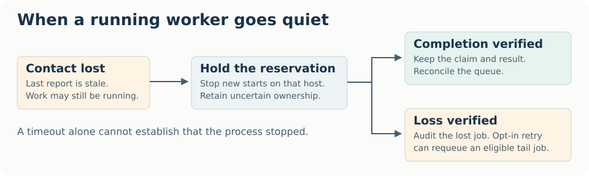

# Operating a small cluster

## Inventory

Copy `examples/cluster.json` to `cluster.local.json`. Set `shared_root` to the
same absolute directory on all machines. Mount it before rendering. Set
`coordinator` to the ID of the machine with locally attached storage. SSH from
the coordinator must reach all inventory targets, including the coordinator.
A host can coordinate even if its worker entry is disabled.

Each host has an ID, an SSH target, a positive CPU allowance, a positive memory
allowance in MiB, and an enabled flag. An SSH target can be an alias from
`~/.ssh/config`. Check the inventory without contacting any machines:

```bash
python3 cluster_config.py cluster.local.json
```

Run `./doctor cluster.local.json` from the coordinator before deployment or
when a worker loses access. It checks noninteractive SSH, Python 3.9+, Bash,
SSH, Perl and shasum. To distinguish the same shared directory from two locally
writable copies, it writes one random marker on the coordinator, reads it from
each host, and creates and removes a tiny write probe on each. It removes the
coordinator marker on completion. Use `--project /absolute/shared/project`
to test project permissions, `--shards` to require GNU Parallel, or `--json` for
per-check results. A failed coordinator or enabled worker makes the command exit
1. Disabled workers are reported separately. Running from another admin host
tests that host’s SSH routes.

Rendering writes a versioned environment, a hosts file and a resource table
under the shared root. Source the environment in each admin shell. After an
inventory change, render again and source the new path. A running adaptive
pool retains its current budgets. Drain it before adopting an edited inventory,
or use the scheduler’s live budget controls.

For a second SSH route, add `fallback` to the host and run
`admin/install_ssh_routes.sh "$PARALLEL_WORKERS_CONFIG_DIR"` on each machine
that initiates those connections. The primary and fallback must reach the same
SSH server. A fallback route carries control traffic. Jobs that need shared
storage still require a working mount.

The example sets `shared_io_capacity` to zero. For the optional SMB admission
guard, set a positive capacity and name the sampling host in `io_pressure_host`.
A job’s default reservation follows the pool setting. Specify `network_interface`
or `disk` when automatic coordinator device selection is unsuitable.

## Submit your own queue


Use the [first-job walkthrough](../examples/first-job/README.md) as a template.
Create `queues/jobs.txt` in a project directory on the shared drive. Each line
contains a unique ID and a shell command. The worker appends
`--job_tag VALUE` to that command. Set separate output paths per job and check
that every eligible host can run the program. Keep the project and queue paths
free of spaces and shell metacharacters.

Run these commands on the coordinator, with the generated environment sourced
and `project` set to your project directory:

```bash
scheduler="$PARALLEL_WORKERS_ROOT/adaptive_scheduler.sh"
"$scheduler" pool-status
"$scheduler" submit --model_dir "$project" --queue jobs.txt \
  --project my-analysis --run_name pilot \
  --cpu_units_per_job 1 --memory_mib_per_job 512 --max_workers 1
```

Use CPU and memory values measured for your job, including child processes.
Copy the printed `batch_dir` into a shell variable called `batch`.
`"$scheduler" queue-status --batch_dir "$batch"` shows the queue lifecycle.
Inspect `$batch/done/` and the application’s outputs before increasing concurrency.
`--after "$batch"` on a later submission makes it wait for successful completion.

Queues default to `--schedule_priority 50`. Give two queues the same priority
when both should make progress. To favor one queue, choose a higher number
than the other active queues in the dashboard’s Priority column. It gets first
choice of eligible free slots as running jobs finish. Smaller jobs from another
queue can still fit where the favored queue cannot.

## Monitor and recover

The direct dashboard samples the hosts over SSH. On a Linux dashboard host, the
optional systemd user service instead collects shared snapshots for the CLI and
Agent Bar. Install it from the checkout with the rendered environment sourced.
Check it with `systemctl --user status parallel-workers-collector` or
`journalctl --user -u parallel-workers-collector`. Rerun the installer after
changing inventories.

### Completion estimates

The adaptive queue ETA answers “When would this queue finish with the pool we
have now?” It measures the time between each successful job’s claim and its
completion, then uses the scheduler’s allocator to project which queue can use
each slot as jobs finish. A running job stays on its host. Queue and host
priorities, worker caps, available CPU and RAM, shared I/O limits, host holds
and queue dependencies constrain new starts.


In this example, B has 50 one-minute jobs left when A finishes. Two workers
finish those jobs in 25 minutes. [Play or step through the timeline](pool-eta.html)
from a local checkout.

The forecast samples up to 128 successful jobs per queue. A host with at least
three sampled completions uses its own mean for that workload. Other hosts use
the queue mean. For a running job the monitor also considers how long it has
already run. Queued time contributes no work. New submissions, future host
changes, startup delays and changes in job mix can move the estimate.
An untimed queue can occupy capacity, and a queue with insufficient timing or
no projected finish shows a blank ETA. If the whole pool snapshot is
unavailable, running rows fall back to the current-allocation estimate.

The shared monitor snapshot carries the pool estimate by default. To compare
both estimates in seconds on the coordinator, run:

```bash
python3 "$PARALLEL_WORKERS_ROOT/monitor_pool_eta.py" --root "$PARALLEL_WORKERS_ROOT" --json
```

`pool_eta_sec` includes capacity released by other queues.
`allocation_eta_sec` keeps each queue at its current worker count.
For a one-off monitor view of the latter, use `monitor_queue_progress.sh
--eta_mode allocation`. Fixed-worker queues and host-local shards retain
their own estimates.

### Interruptions and recovery



To pause admissions for one queue, run `"$scheduler" pause --batch_dir "$batch"`.
Its running jobs finish. Resume with the same command using `resume`.
For maintenance, `"$scheduler" pool-drain` stops new admissions across the pool.
Check `pool-status` until drain completes before updating deployed scripts.

An unreachable worker may still be computing. After an interruption, restore
storage and connectivity first, inspect queue status, completion markers and
outputs, and reconcile uncertain jobs before retrying them. If the coordinator
process exited, record the pool ID from `pool-status` and confirm the original
process is gone. An active pool can be recovered with the same identity using
`"$scheduler" pool-start --recover-inactive --expected-pool-id "$pool_id"`.
For a pool already draining, use `pool-drain --recover-inactive` with the
same expected ID. Run `"$scheduler" --help` for the recovery and audit commands.

## Execution modes

The adaptive pool shares CPU and RAM among multiple queues. The fixed shared
queue starts a specified number of workers per host. Host-local shards reduce
shared scheduler traffic for short jobs and use GNU Parallel on the workers.
The deployed `start_workers.sh --help` describes both fixed modes. Hosts in a
mixed-architecture pool must have compatible job executables and dependencies.
