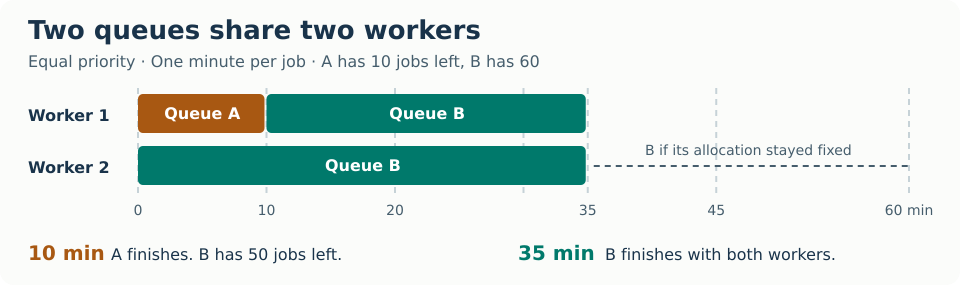

# Operating a small cluster

## Inventory

Copy `examples/cluster.json` to `cluster.local.json`. Set `shared_root` to the
same absolute directory on all machines. Mount it before rendering. Set
`coordinator` to the ID of the machine with locally attached storage. SSH from
the coordinator must reach all inventory targets, including the coordinator.
A host can coordinate even if its worker entry is disabled.

Each host has an ID, an SSH target, a positive CPU allowance, a positive memory
allowance in MiB, and an enabled flag. An SSH target can be an alias from
`~/.ssh/config`. Check the inventory without contacting any machines:

```bash
python3 cluster_config.py cluster.local.json
```

Run `./doctor cluster.local.json` from the coordinator before deployment or
when a worker loses access. It checks noninteractive SSH, Python 3.9+, Bash,
SSH, Perl and shasum. To distinguish the same shared directory from two locally
writable copies, it writes one random marker on the coordinator, reads it from
each host, and creates and removes a tiny write probe on each. It removes the
coordinator marker on completion. Use `--project /absolute/shared/project`
to test project permissions, `--shards` to require GNU Parallel, or `--json` for
per-check results. A failed coordinator or enabled worker makes the command exit
1. Disabled workers are reported separately. Running from another admin host
tests that host’s SSH routes.

Rendering writes a versioned environment, a hosts file and a resource table
under the shared root. Source the environment in each admin shell. After an
inventory change, render again and source the new path. A running adaptive
pool retains its current budgets. Drain it before adopting an edited inventory,
or use the scheduler’s live budget controls.

For a second SSH route, add `fallback` to the host and run
`admin/install_ssh_routes.sh "$PARALLEL_WORKERS_CONFIG_DIR"` on each machine
that initiates those connections. The primary and fallback must reach the same
SSH server. A fallback route carries control traffic. Jobs that need shared
storage still require a working mount.

The example sets `shared_io_capacity` to zero. For the optional SMB admission
guard, set a positive capacity and name the sampling host in `io_pressure_host`.
A job’s default reservation follows the pool setting. Specify `network_interface`
or `disk` when automatic coordinator device selection is unsuitable.

## Submit your own queue


Use the [first-job walkthrough](../examples/first-job/README.md) as a template.
Create `queues/jobs.txt` in a project directory on the shared drive. Each line
contains a unique ID and a shell command. The worker appends
`--job_tag VALUE` to that command. Set separate output paths per job and check
that every eligible host can run the program. Keep the project and queue paths
free of spaces and shell metacharacters.

Run these commands on the coordinator, with the generated environment sourced
and `project` set to your project directory:

```bash
scheduler="$PARALLEL_WORKERS_ROOT/adaptive_scheduler.sh"
"$scheduler" pool-status
"$scheduler" submit --model_dir "$project" --queue jobs.txt \
  --project my-analysis --run_name pilot \
  --cpu_units_per_job 1 --memory_mib_per_job 512 --max_workers 1
```

Use CPU and memory values measured for your job, including child processes.
Copy the printed `batch_dir` into a shell variable called `batch`.
`"$scheduler" queue-status --batch_dir "$batch"` shows the queue lifecycle.
Inspect `$batch/done/` and the application’s outputs before increasing concurrency.
`--after "$batch"` on a later submission makes it wait for successful completion.

For long-running queues, check the dashboard’s Priority column and choose an
unused `--schedule_priority` (default 50). Give higher numbers to queues whose
results you want first. They get first choice of eligible slots as jobs finish.
Reuse a priority only when you want those queues to share workers and make
progress together.

## Monitor and recover

The direct dashboard samples the hosts over SSH. On a Linux dashboard host, the
optional systemd user service instead collects shared snapshots for the CLI and
Agent Bar. Install it from the checkout with the rendered environment sourced.
Check it with `systemctl --user status parallel-workers-collector` or
`journalctl --user -u parallel-workers-collector`. Rerun the installer after
changing inventories.

### Completion estimates

The adaptive queue ETA answers “When would this queue finish with the pool we
have now?” It measures the time between each successful job’s claim and its
completion, then uses the scheduler’s allocator to project which queue can use
each slot as jobs finish. A running job stays on its host. Queue and host
priorities, worker caps, available CPU and RAM, shared I/O limits, host holds
and queue dependencies constrain new starts.



In this example, B has 50 one-minute jobs left when A finishes. Two workers
finish those jobs in 25 minutes. [Play or step through the timeline](pool-eta.html)
from a local checkout.

The forecast assumes no new submissions. Pending jobs use the mean runtime of
up to 128 successful jobs in the queue. A host with at least three sampled
completions uses its own mean. Running jobs are credited for time already spent.
For future launches the monitor also includes the typical gap between jobs
when it observes at least five consecutive same-host refills for that queue.
Very short jobs may spend as much time waiting for the next launch as computing.

For an early estimate, add `--early_eta_sample` to an adaptive submission
with at least 20 jobs. Its first two ordinary jobs can take an eligible free
slot ahead of their queue's priority, one at a time. The pool allows one such
slot across all opted-in queues. Dependencies, pauses, host restrictions and
resource limits still apply. Jobs started at normal priority count toward
the two, and the first successful completion can supply an ETA.

A `?` beside a dashboard ETA or a timing note in Agent Bar flags a change in
the job mix or a running job that has outlasted the sample. The estimate still
assumes average remaining jobs. The JSON report includes the mean runtime,
sample count, measured dispatch gaps and warning.
An untimed queue can occupy capacity, and a queue with insufficient timing or
no projected finish shows a blank ETA. If the whole pool snapshot is
unavailable, running rows fall back to the current-allocation estimate.

The desktop collector saves each numeric ETA it observes. To compare the
first forecast in each quarter of a queue's progress with its completion time,
run `python3 queue_eta_history.py` on the collector host. Use `--all` for every
forecast, `--queue <label-or-id>` to filter, or `--json` for timestamps and
errors in seconds. Positive errors mean a late finish. Open and unsuccessful queues have
no scored error. The history includes worker counts and timing warnings from
when each estimate was made, and survives collector restarts.

The shared monitor snapshot carries the pool estimate by default. To compare
both estimates in seconds on the coordinator, run:

```bash
python3 "$PARALLEL_WORKERS_ROOT/monitor_pool_eta.py" --root "$PARALLEL_WORKERS_ROOT" --json
```

`pool_eta_sec` includes capacity released by other queues.
`allocation_eta_sec` keeps each queue at its current worker count.
For a one-off monitor view of the latter, use `monitor_queue_progress.sh
--eta_mode allocation`. Fixed-worker queues and host-local shards retain
their own estimates.

### Interruptions and recovery


To pause admissions for one queue, run `"$scheduler" pause --batch_dir "$batch"`.
Its running jobs finish. Resume with the same command using `resume`.
For maintenance, `"$scheduler" pool-drain` stops new admissions across the pool.
Check `pool-status` until drain completes before updating deployed scripts.

An unreachable worker may still be computing. After an interruption, restore
storage and connectivity first, inspect queue status, completion markers and
outputs, and reconcile uncertain jobs before retrying them. If the coordinator
process exited, record the pool ID from `pool-status` and confirm the original
process is gone. An active pool can be recovered with the same identity using
`"$scheduler" pool-start --recover-inactive --expected-pool-id "$pool_id"`.
For a pool already draining, use `pool-drain --recover-inactive` with the
same expected ID. Run `"$scheduler" --help` for the recovery and audit commands.

## Execution modes

The adaptive pool shares CPU and RAM among multiple queues. The fixed shared
queue starts a specified number of workers per host. Host-local shards reduce
shared scheduler traffic for short jobs and use GNU Parallel on the workers.
The deployed `start_workers.sh --help` describes both fixed modes. Hosts in a
mixed-architecture pool must have compatible job executables and dependencies.

## Opt-in host and queue features

These change nothing unless the inventory or a submission sets them. Inventory
settings take effect at the next pool start (drain, render, deploy, start).

**Owner activity.** For a machine someone also uses at the keyboard:

```json
{"id": "desk", "ssh": "user@desk", "cpu_units": 8, "memory_mib": 12288,
 "enabled": true, "owner_idle_seconds": 300, "owner_active": "suspend"}
```

Each resource sample, the agent reads how long the console has been idle: macOS
`HIDIdleTime`, or the Linux graphical session's logind idle hint. While the
owner has been idle for less than `owner_idle_seconds` (60–86400), the host starts
no new jobs, as if it were away. Running jobs continue and stay charged. If the
idle time cannot be read, including a failed logind query, the host also starts
nothing (`owner_unknown`).
Linux desktops set the idle hint only after their own idle delay, which therefore
acts as a floor on `owner_idle_seconds`.

`owner_active: "suspend"` also stops every process of the host's running jobs
(SIGSTOP) while the owner is active, and continues them (SIGCONT) once the owner
has been idle long enough. The agent records the jobs it is about to stop before
stopping them, so an agent that exits, crashes or restarts resumes them first. Suspended jobs still hold their memory, their wall time keeps
counting (so queue ETAs and backfill estimates see longer jobs), and a pool drain
waits for them. The default `"hold"` never stops a running job.

**Devices (GPUs).** Give a host `"gpu_units": 2` and submit with
`--gpu_units_per_job 1`. Device units are a fourth resource next to CPU, memory and
shared I/O: a queue runs only where enough are free, and a large request reserves
a drain host like a large CPU or memory request. The agent assigns specific
indices (0, 1, …) and exports them to the job as `CUDA_VISIBLE_DEVICES` and
`PW_GPU_DEVICES`. The scheduler does not measure GPU use by other programs. A
Mac's GPU cannot be divided, so `gpu_units: 1` there just runs one GPU job at a
time.

**Memory limit.** `--memory_limit_mib N` (at least `--memory_mib_per_job`) ends a
job whose process tree uses more than N MiB at a resource sample: SIGTERM first,
then SIGKILL at each later sample while it still runs, even if its memory has
dropped. The job counts as failed even if it exits 0, so it writes no done marker
and unlocks no dependent stage, and repeated fast failures still place a failure
hold. Processes it leaves behind in its session are killed, and the job log ends
with the reason. Sampling is every few seconds, so a fast spike can pass between
samples. Declared memory remains the admission floor, and `set-memory` refuses a
floor above the limit.

**Backfill.** With `"backfill": true` at the top level of the inventory, capacity
held back for a large job (a drain reservation) may run a shorter job when that
job's 90th-percentile runtime, plus 30 s, ends before the large job could fit. The
coordinator measures runtimes from claim and done times of each queue's last 30
completed jobs, and needs at least 5. It forecasts when the large job fits from
the 10th-percentile runtimes of the jobs that must finish first. A job without an
estimate may end at any moment, so it makes the forecast earlier and allows less
backfill. A backfilled job that runs past its 90th percentile delays the large
job, which is why backfill is opt-in. `pool-start --backfill 0|1` overrides the
rendered default.

**CPU time of finished jobs** is always recorded. Each finished job writes
`usage/job_<ID>.env` in its batch: user and system CPU seconds of its process
tree, wall seconds and exit code. The job log ends with a `CPU:` line. Adaptive
queue status reports `cpu_seconds_succeeded`, `cpu_seconds_failed` and
`jobs_with_usage`. The dashboard snapshot (`cluster-status.json`) reports them
as CPU-hours in each queue row's `usage`. A finished queue keeps its final totals
there for a week, from the coordinator's `retired/` index.
